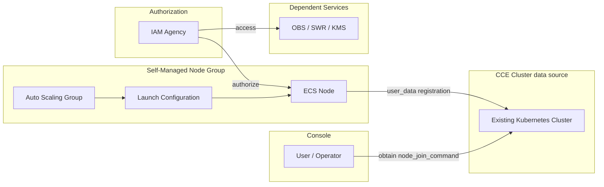

# distributed-x-infrastructure-cce-self-managed-node-group


## 1. Overview

This repository provides a Terraform module that demonstrates how to assemble a **Cloud Container Engine (CCE) self-managed node group** from basic Huawei Cloud resources: the nodes are fully under your control rather than using a platform-managed node pool. The module combines Auto Scaling (AS), Elastic Cloud Server (ECS), Identity and Access Management (IAM) agency, the CCE node image, and a node registration script — a set of self-managed primitives that give you complete control over the node lifecycle. It is intended for learning and teaching scenarios where you want to manage Kubernetes nodes on Huawei Cloud by building them from foundational resources and understand exactly what makes up a node group.

## 2. Table of Contents

- [1. Overview](#1-overview)
- [2. Table of Contents](#2-table-of-contents)
- [3. Architecture](#3-architecture)
- [4. Highlights](#4-highlights)
- [5. Cloud Services Used](#5-cloud-services-used)
- [6. Prerequisites](#6-prerequisites)
- [7. Quick Start](#7-quick-start)
- [8. Step-by-Step Deployment](#8-step-by-step-deployment)
- [9. Usage and Verification](#9-usage-and-verification)
- [10. Cleanup](#10-cleanup)
- [11. Architecture Details](#11-architecture-details)
- [12. Dependencies](#12-dependencies)
- [13. FAQ](#13-faq)
- [14. Contributing](#14-contributing)
- [15. License](#15-license)
- [16. Contact](#16-contact)

## 3. Architecture

> Assemble a self-managed node group from basic resources: Auto Scaling (AS) group + launch configuration + IAM agency + CCE node image + node registration `user_data`.



**Key components**:

- **CCE cluster (data source)**: reads the existing cluster's endpoint / CA / security group / VPC / subnets.
- **Auto Scaling group + launch configuration**: carries desired / min / max, subnets, security groups, cluster tags and the node lifecycle.
- **IAM agency**: the node ECS obtains access to OBS / SWR / KMS through the agency (Huawei Cloud internal service account `op_svc_ecs`).
- **Node registration**: `user_data` executes the registration command on first boot to join the CCE cluster.

## 4. Highlights

- **Fully self-managed**: Nodes are composed of an AS group, a launch configuration, an IAM agency, a node image, and a registration script — no managed node pool is introduced, so the node lifecycle is entirely controllable.
- **Foundational primitive teaching**: A minimal, credible demonstration of what makes up a self-managed node group, making each primitive's role easy to understand.
- **Edge support**: A CloudPond intelligent edge site deployment example covering edge availability-zone scenarios.
- **Disk encryption**: The data disk supports Key Management Service (KMS) encryption; full encryption is recommended for edge scenarios.

## 5. Cloud Services Used

Huawei Cloud services used in this practice:

- **Cloud Container Engine (CCE)**: The Kubernetes cluster (must already exist; the module reads its information via a data source)
- **Elastic Cloud Server (ECS)**: Node compute instances
- **Auto Scaling (AS)**: Scaling group and launch configuration
- **Identity and Access Management (IAM)**: Node IAM agency
- **Image Management Service (IMS)**: CCE node image
- **Key Management Service (KMS)**: Data disk encryption key
- **Virtual Private Cloud (VPC)**: Cluster network and subnets

> Release resources promptly after deployment to avoid residue.

## 6. Prerequisites

- A Huawei Cloud account with permissions to create Auto Scaling, ECS, IAM agency, and CCE related resources.
- Terraform (≥ 1.5) and the Huawei Cloud Terraform Provider (`huaweicloud` ~> 1.96) installed.
- Access credentials configured (obtain the Access Key from the Huawei Cloud "My Credentials" page and provide it to the deployment environment; credentials are passed only as variables and never written into any file).
- An existing CCE cluster, along with subnets under the cluster's VPC.

## 7. Quick Start

With an existing CCE cluster, deploy a regional self-managed node group using the following commands:

```bash
cd distributed-x-infrastructure-cce-self-managed-node-group/infra

terraform init

terraform apply \
  -var="cce_cluster_name=my-cce-cluster" \
  -var="flavor=s6.large.2" \
  -var="desired_capacity=2" \
  -var="min_size=1" \
  -var="max_size=4" \
  -var="subnets=<subnet-id-1>,<subnet-id-2>" \
  -var="node_join_command=<node-join-command-from-cce-console>"
```

The `node_join_command` is copied from the target CCE cluster console under "Add Node → Custom Node".

## 8. Step-by-Step Deployment

The full step-by-step flow (init, plan, apply, verify, cleanup) is described in [docs/deployment-guide.md](./docs/deployment-guide.md).

## 9. Usage and Verification

The minimal usage (regional deployment) is the `terraform apply` shown in Quick Start. After a successful deployment, wait for the nodes to finish their first boot and registration, then confirm node status in an environment with a configured kubeconfig:

```bash
kubectl get nodes -l kubernetes.io/cluster/my-cce-cluster
```

Expected output: nodes in `Ready` state, with labels such as `node.kubernetes.io/node-group` (if `node_labels` was provided).

> **Verification reminder**: After deployment, please verify using the steps in this section and confirm that nodes have joined the cluster and the functionality works before considering the delivery complete.

## 10. Cleanup

Release resources to avoid residue:

```bash
cd distributed-x-infrastructure-cce-self-managed-node-group/infra
terraform destroy \
  -var="cce_cluster_name=my-cce-cluster" \
  -var="flavor=s6.large.2" \
  -var="desired_capacity=2" \
  -var="min_size=1" \
  -var="max_size=4" \
  -var="subnets=<subnet-id-1>,<subnet-id-2>" \
  -var="node_join_command=<node-join-command-from-cce-console>"
```

## 11. Architecture Details

Architecture, resource composition, the node registration mechanism, edge (CloudPond) scenarios, disk and encryption, and security group association are detailed in [docs/architecture.md](./docs/architecture.md).

Core resource types:

- `data "huaweicloud_cce_cluster"`: reads the existing cluster's endpoint / CA / security group / VPC / subnets
- `data "huaweicloud_images_image"`: resolves the latest CCE node image by name regex
- `huaweicloud_identity_agency`: node IAM agency (`delegated_service_name = "op_svc_ecs"`, bound to project roles such as OBS / SWR)
- `huaweicloud_as_configuration`: launch configuration (flavor / image / key pair / agency / security groups / user_data / system disk + data disk)
- `huaweicloud_as_group`: Auto Scaling group (desire / min / max + subnets + security groups + cluster tags)
- `infra/user_data.sh`: node registration script that executes the registration command to join the cluster on first boot

## 12. Dependencies

- [Terraform](https://www.terraform.io/) ≥ 1.5
- Huawei Cloud Terraform Provider `huaweicloud` ~> 1.96
- `random` provider ~> 3.1.0
- `kubectl` (only for verifying node status after deployment)

## 13. FAQ

**Nodes stay in NotReady?**
- Check whether `node_join_command` has expired (the registration token is time-limited); copy a fresh one from the console and run `terraform apply`.
- Confirm the node subnet has network connectivity to the CCE control plane and that security groups are correctly associated.

**The scaling group created instances but the cluster shows no nodes?**
- Node registration depends on `user_data.sh` running on first boot; inspect the instance boot log to confirm the registration command executed successfully.
- Confirm the IAM agency was created correctly and bound to the project roles.

**How to deploy at the edge?**
- See `examples/on-prem/`: point `subnets` to a CloudPond edge availability-zone subnet and enable `data_volume_encrypted` + `kms_key_id`.

## 14. Contributing

Improvements via Pull Request are welcome. Please read [CONTRIBUTING.md](./CONTRIBUTING.md) before submitting.

## 15. License


This practice is distributed under the **MIT No Attribution (MIT-0)** license. You may freely use, modify, and redistribute the contents of this repository without attribution or retention of copyright notices. The full license text is in [LICENSE](./LICENSE).

## 16. Contact

| Item | Content |
|---|---|
| **Creator** | [@dgc-git](https://github.com/dgc-git) |
| **Maintainer** | [@dgc-git](https://github.com/dgc-git) |
| **Contact** | Report issues or suggestions through the repository Issues |
