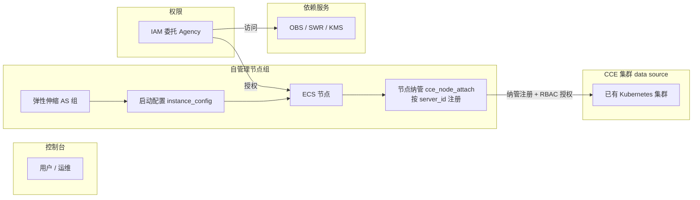

# distributed-x-infrastructure-cce-self-managed-node-group


## 1. 简介 / Overview

本仓库提供一套 Terraform 模块，演示如何用华为云的基础资源**自行拼装一个 CCE 自管理节点组（self-managed node group）**：节点完全由用户掌控，而非使用平台托管的节点池。模块把弹性伸缩 AS、ECS、IAM 委托与节点纳管（`huaweicloud_cce_node_attach`，按 `server_id` 将 AS 拉起的 ECS 注册进集群）这组可自管的原语组合在一起，让用户完整掌控节点的生命周期。适用于希望在华为云上以「基础资源自建」方式管理 Kubernetes 节点、并深入理解节点组构成的学习与教学场景。

## 2. 目录

- [1. 简介 / Overview](#1-简介--overview)
- [2. 目录](#2-目录)
- [3. 架构图](#3-架构图)
- [4. 方案亮点](#4-方案亮点)
- [5. 涉及云服务](#5-涉及云服务)
- [6. 前置条件](#6-前置条件)
- [7. 快速开始](#7-快速开始)
- [8. 分步部署](#8-分步部署)
- [9. 使用方法与验证](#9-使用方法与验证)
- [10. 清理资源](#10-清理资源)
- [11. 详细说明](#11-详细说明)
- [12. 依赖](#12-依赖)
- [13. FAQ / 常见问题](#13-faq--常见问题)
- [14. 贡献指南](#14-贡献指南)
- [15. 许可证](#15-许可证)
- [16. 联系方式 / 维护者](#16-联系方式--维护者)

## 3. 架构图

> 用基础资源自行拼装一个自管理节点组：弹性伸缩 AS 组 + 启动配置 + IAM 委托 + 节点纳管（cce_node_attach）。



**关键组件说明**：

- **CCE 集群（data source）**：读取已存在集群的 endpoint / CA / 安全组 / VPC / 子网。
- **弹性伸缩 AS 组 + 启动配置**：承载 desired / min / max、子网、安全组、集群标签与节点生命周期。
- **IAM 委托**：节点 ECS 经委托获得访问 OBS / SWR / KMS 的权限（华为云内部服务账号 `op_svc_ecs`）。
- **节点注册**：AS 组拉起 ECS 后，由 `huaweicloud_cce_node_attach` 按 `server_id` 将实例纳管进集群；纳管过程重置节点系统为 CCE 标准镜像，并由控制面自动完成节点 RBAC 授权与标签下发。

## 4. 方案亮点

- **完全自管**：节点由弹性伸缩组、启动配置、IAM 委托、节点镜像与注册脚本共同构成，不引入托管节点池，节点生命周期完全可控。
- **基础原语教学**：以最小可信演示呈现「自管理节点组」的构成，便于理解每个原语的作用。
- **边缘支持**：提供 CloudPond 智能边缘小站部署示例，覆盖边缘可用区场景。
- **磁盘加密**：数据盘支持 KMS 加密，边缘场景建议全量开启。

## 5. 涉及云服务

本实践使用的华为云服务：

- **云容器引擎 CCE**：Kubernetes 集群（须已存在，模块以 data source 读取其信息）
- **弹性云服务器 ECS**：节点计算实例
- **弹性伸缩 AS**：伸缩组与启动配置
- **统一身份认证 IAM**：节点 IAM 委托（Agency）
- **镜像服务 IMS**：CCE 节点镜像
- **密钥管理服务 KMS**：数据盘加密密钥
- **虚拟私有云 VPC**：集群网络与子网

> 部署完成后请及时释放资源，避免残留。

## 6. 前置条件

- 华为云账号，具备创建弹性伸缩、ECS、IAM 委托、CCE 相关资源的权限。
- 已安装 Terraform（≥ 1.5）与华为云 Terraform Provider（huaweicloud ~> 1.96）。
- 已配置访问凭证（在华为云「我的凭证」页面获取 Access Key 并填入部署环境；凭据仅以变量传入，不写入任何文件）。
- 一个已存在的 CCE 集群，以及该集群所在 VPC 下的若干子网。

## 7. 快速开始

在已存在 CCE 集群的前提下，进入示例目录部署一个区域自管理节点组。由于节点注册依赖 AS 组拉起的 ECS 实例 ID，需**两阶段 apply**（先建节点组，实例就绪后自动纳管）：

```bash
cd distributed-x-infrastructure-cce-self-managed-node-group/examples/region

# 按注释填好集群名、子网 ID、镜像 ID 后：
terraform init

# 阶段一：创建密钥对、IAM 委托、AS 启动配置与 AS 组（AS 组随即拉起 ECS 节点）
terraform apply -target=huaweicloud_compute_keypair.node \
                -target=module.cce_self_managed_node_group

# 阶段二：实例进入运行中后，重新 apply，huaweicloud_cce_node_attach
#         按 server_id 将节点纳管进集群（重试几次直到 Apply complete）
terraform apply
```

其中节点注册由示例中的 `huaweicloud_cce_node_attach` 资源完成（公有云 CCE 不提供「节点注册命令」，纳管是官方唯一对已有 ECS 的接入方式）。

## 8. 分步部署

完整分步流程（含初始化、规划、部署、验证、清理）见 [docs/deployment-guide.md](./docs/deployment-guide.md)。

## 9. 使用方法与验证

最简用法（区域部署）即上文「快速开始」中的两阶段 `terraform apply`。部署成功后，等待节点完成纳管与首次启动，在已配置 kubeconfig 的环境中确认节点状态：

```bash
kubectl get nodes -l node.kubernetes.io/node-group=node-group-a
```

预期输出：节点处于 `Ready` 状态，并带 `node.kubernetes.io/node-group` 等标签（若传入 `node_labels`）。

> **验证提醒**：部署完成后请按本节步骤自行验证，确认节点成功加入集群、业务功能可用，方可视为交付完成。

## 10. 清理资源

释放资源，避免残留：

```bash
cd distributed-x-infrastructure-cce-self-managed-node-group/examples/region
terraform destroy
```

## 11. 详细说明

架构与资源组成、节点注册机制、边缘（CloudPond）场景、磁盘与加密、安全组关联等详见 [docs/architecture.md](./docs/architecture.md)。

核心资源类型：

- `data "huaweicloud_cce_cluster"`：读取已存在集群的 endpoint / CA / 安全组 / VPC / 子网
- `data "huaweicloud_images_image"`：按名称正则取节点镜像（或直接传 `image_id`）
- `huaweicloud_identity_agency`：节点 IAM 委托（`delegated_service_name = "op_svc_ecs"`，绑定 OBS / SWR 等项目角色）
- `huaweicloud_as_configuration`：启动配置（规格 / 镜像 / 密钥对 / 委托 / 安全组 / user_data / 系统盘 + 数据盘）
- `huaweicloud_as_group`：弹性伸缩组（desired / min / max + 子网 + 安全组 + 集群标签）
- `data "huaweicloud_as_instances"`：列出 AS 组拉起的 ECS 实例（示例中用于纳管）
- `huaweicloud_cce_node_attach`：节点纳管注册（示例中按 `server_id` 将实例注册进集群，重置系统并下发 Kubernetes 标签）
- `infra/user_data.sh`：节点首次启动预置脚本（不执行注册命令）

## 12. 依赖

- [Terraform](https://www.terraform.io/) ≥ 1.5
- 华为云 Terraform Provider `huaweicloud` ~> 1.96
- `random` provider ~> 3.1.0
- `kubectl`（仅用于部署后验证节点状态）

## 13. FAQ / 常见问题

**节点一直处于 NotReady？**
- 确认节点已完成 `huaweicloud_cce_node_attach` 纳管（纳管过程会重置系统，需数分钟）。
- 确认节点子网与 CCE 集群控制面网络连通，安全组已正确关联。

**伸缩组创建了实例但集群看不到节点？**
- 节点注册依赖 `huaweicloud_cce_node_attach` 纳管；AS 组拉起实例后需再次 `terraform apply` 触发纳管（实例须为运行中且健康）。
- 确认 IAM 委托已正确创建并绑定项目角色。

**apply 报 403「Only administrators can handle sys tags」？**
- CCE 纳管后会给 ECS 打平台系统标签（如 `CCE-Dynamic-Provisioning-Node`），该标签由平台管理。示例中的 attach 资源已通过 `lifecycle { ignore_changes = [tags] }` 规避，请勿自行移除该配置。

**边缘场景如何部署？**
- 见 `examples/on-prem/`：将 `subnets` 指向 CloudPond 边缘可用区子网，并建议开启 `data_volume_encrypted` + `kms_key_id`。

## 14. 贡献指南

欢迎通过 Pull Request 贡献改进。提交前请阅读 [CONTRIBUTING.md](./CONTRIBUTING.md)。

## 15. 许可证


本实践采用 **MIT No Attribution（MIT-0）** 许可证。您可自由使用、修改和分发本仓库内容，无需署名或保留版权声明。许可证全文见 [LICENSE](./LICENSE)。

## 16. 联系方式 / 维护者

| 项 | 内容 |
|---|---|
| **创建者** | [@dgc-git](https://github.com/dgc-git) |
| **维护者** | [@dgc-git](https://github.com/dgc-git) |
| **联系方式** | 通过仓库 Issue 反馈问题或建议 |
