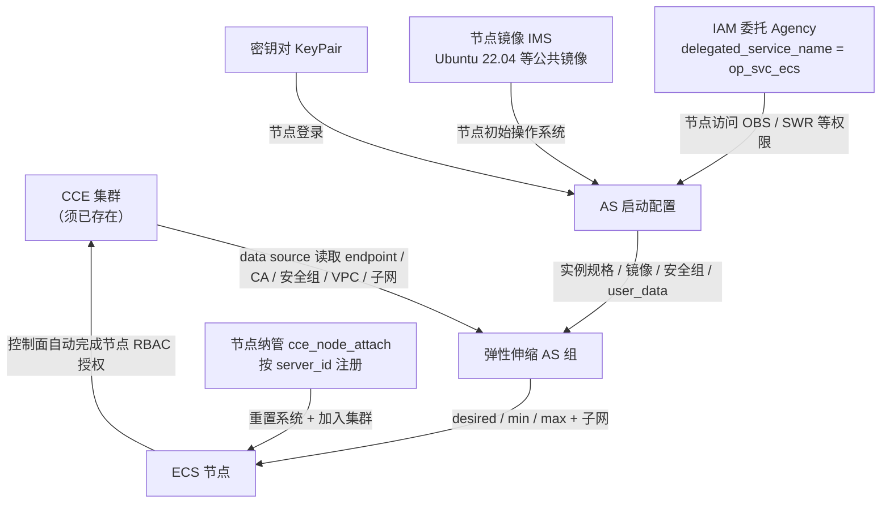

# 架构说明

本实践演示如何用华为云的一组基础资源，自行拼装出一个 **CCE 自管理节点组（self-managed node group）**：节点完全由用户掌控，而不是使用平台托管的节点池。其核心教学点在于——通过弹性伸缩 AS、ECS、IAM 委托、CCE 节点镜像与节点注册脚本这组可自管的原语，把计算实例组装成 Kubernetes 集群的节点组，从而完整掌控节点的生命周期。

## 架构图

## 节点注册机制

节点要被 CCE 集群接纳，需要两件事：

1. **节点纳管**：公有云 CCE 不提供「节点注册命令」（控制台无该入口）。对已有 ECS 的唯一官方接入方式是**纳管**——本实践在示例中用 `huaweicloud_cce_node_attach` 资源实现：`data "huaweicloud_as_instances"` 列出 AS 组拉起的实例（过滤 `INSERVICE` + `NORMAL`），按 `server_id` 逐一纳管。纳管过程会将节点系统重置为 CCE 标准镜像（`os` 参数指定，如 `Ubuntu 22.04`），并通过 `labels` 参数下发 Kubernetes 标签。纳管要求实例 ≥ 2核4GiB、挂载一块 ≥ 20GiB 数据盘、与集群同 VPC。
2. **IAM 委托**：节点 ECS 通过 IAM 委托（`delegated_service_name = "op_svc_ecs"`）获得访问 OBS / SWR 等服务的权限，对应节点所需的服务访问授权。

CCE 控制面在节点纳管时**自动完成节点 RBAC 授权**，无需用户手动维护节点授权映射。

> **实现细节**：CCE 纳管后会给 ECS 打平台系统标签（如 `CCE-Dynamic-Provisioning-Node`），该标签由平台管理、普通账号无权修改；attach 资源须配置 `lifecycle { ignore_changes = [tags] }`，否则后续 apply 会因尝试改系统标签报 403（`Ecs.1000`）。

## 资源组成

| 资源 | 资源类型 | 说明 |
|---|---|---|
| CCE 集群（已存在） | `data "huaweicloud_cce_cluster"` | 读取集群 endpoint / CA / 安全组 / VPC / 子网 |
| 节点镜像 | `data "huaweicloud_images_image"` | 按 `image_name_regex` 取最新匹配镜像（或直接传 `image_id`） |
| 节点 IAM 委托 | `huaweicloud_identity_agency` | `delegated_service_name = "op_svc_ecs"`，绑定项目角色（OBS / SWR 等） |
| 启动配置 | `huaweicloud_as_configuration` | 实例规格 / 镜像 / 密钥对 / 委托 / 安全组 / user_data / 系统盘 + 数据盘 |
| 弹性伸缩组 | `huaweicloud_as_group` | desired / min / max 节点数 + 子网 + 安全组 + 集群标签 |
| AS 实例列表 | `data "huaweicloud_as_instances"` | 列出 AS 组拉起的 ECS 实例（示例中用于纳管发现） |
| 节点纳管 | `huaweicloud_cce_node_attach` | 按 `server_id` 将实例注册进集群，重置系统并下发 Kubernetes 标签（示例中声明） |
| 节点初始化脚本 | `infra/user_data.sh` | 节点首次启动预置动作（不执行注册命令） |

## 边缘场景（CloudPond 智能边缘小站）

标准区域部署之外，本实践支持在 **CloudPond 智能边缘小站** 上部署自管理节点组：将节点子网落在 CloudPond 边缘可用区，数据盘加密沿用 KMS。对应示例见 `examples/on-prem/`。

## 磁盘与加密

- 系统盘（`SYS`）：默认 50 GB GPSSD，随启动配置创建。
- 数据盘（`DATA`）：默认 100 GB GPSSD；`data_volume_encrypted = true` 时启用加密，需提供 `kms_key_id`。边缘场景建议对数据盘全量加密。

## 安全组

模块自动关联 CCE 集群的节点安全组，并叠加用户通过 `security_group_ids` 传入的额外安全组，确保节点与控制面、节点间通信正常。
